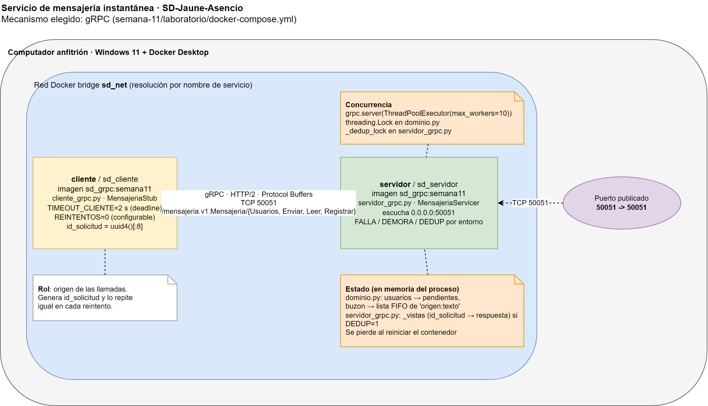

# Reporte de Servicios Cliente-Servidor

**Equipo** SD-Jaune-Asencio
**Integrantes** Diego Jaune y Sebastián Asencio
**Dominio** Mensajería instantánea
**Repositorio** https://github.com/Tiannn21/sd-jaune-asencio
**Fecha** 20-11-2026

Desde la semana 4 implementamos el mismo servicio de mensajería con distintos mecanismos de comunicación: sockets TCP con un protocolo de texto, REST, mensajes estructurados, JSON-RPC, gRPC y objetos remotos con Pyro5. Para la presentación nos quedamos con gRPC. En un chat lo más grave es que un mensaje llegue repetido o se pierda. Probamos que en los tres últimos mecanismos un envío repetido se aplica dos veces, y gRPC fue el que nos dio mejores herramientas para evitarlo: un identificador de solicitud declarado en el contrato, un plazo en cada llamada y códigos de error que indican cuándo conviene reintentar.

## 1. El servicio y su dominio

El servicio permite que usuarios registrados se manden mensajes de texto. Cada usuario tiene un buzón donde se van guardando los mensajes que recibe, en el orden en que llegan, y un contador de pendientes que baja a medida que los lee (`proyecto/ALCANCE.md`).

Las reglas del dominio están en `semana-11/laboratorio/dominio.py`, que no tiene nada de red. Esto nos permitió usar el mismo archivo con gRPC, JSON-RPC y Pyro5 sin modificarlo.

| Operación | Qué hace | ¿Cambia el estado? |
|---|---|---|
| `usuarios` | Lista a cada usuario con sus pendientes | No |
| `registrar` | Crea un usuario con cero pendientes y buzón vacío | Sí |
| `enviar` | Deja `origen:texto` en el buzón del destino y le suma un pendiente | Sí |
| `leer` | Descuenta pendientes y entrega los mensajes más antiguos primero | Sí |

El servicio parte con dos usuarios, `ana` y `beto`, con 100 pendientes cada uno. Esos 100 vienen de la semana 6 y son solo un contador, no mensajes reales. Todo el estado está en memoria, en un diccionario protegido por un `threading.Lock`. En la semana 6 comprobamos por qué hace falta: veinte clientes descontaron 80 pendientes al mismo tiempo y, sin el candado, `ana` terminó con 86 y 85 en dos corridas, cuando tenía que quedar en 20 (`semana-06/laboratorio/observaciones.md`).

`enviar` y `leer` son las operaciones delicadas, porque cambian el estado y no son idempotentes. Si se aplican dos veces, el destinatario ve el mensaje repetido o pierde mensajes de su buzón.

## 2. Arquitectura y topología



*Figura 1. Despliegue del servicio con gRPC (`semana-11/laboratorio/docker-compose.yml`).*

El despliegue tiene dos contenedores conectados a la red Docker `sd_net`, los dos construidos con la imagen `sd_grpc:semana11`.

El **`servidor`** (`sd_servidor`) escucha en el puerto 50051, que también está publicado en el anfitrión como `50051 -> 50051`. Atiende las llamadas con un pool de diez hilos (`ThreadPoolExecutor(max_workers=10)`) y es el único nodo que guarda estado: los usuarios y buzones de `dominio.py` y, cuando se activa `DEDUP=1`, la tabla `_vistas`, donde registra cada `id_solicitud` atendido junto con la respuesta que entregó. Con las variables `FALLA`, `DEMORA` y `DEDUP` se cambia su comportamiento ante fallas sin tocar el código.

El **`cliente`** (`sd_cliente`) hace todas las llamadas con el stub `MensajeriaStub`, generado desde el contrato. Encuentra al servidor por su nombre (`servidor:50051`) gracias al DNS de Docker, por lo que no hay IP escritas en el código. Cada llamada tiene un plazo de 2 segundos (`TIMEOUT_CLIENTE`). En las operaciones que cambian el estado, el cliente genera un `id_solicitud` y repite ese mismo valor si tiene que reintentar.

Entre los dos nodos hay una sola conexión: gRPC, es decir, Protocol Buffers sobre HTTP/2, por TCP en el puerto 50051, hacia los métodos `Usuarios`, `Enviar`, `Leer` y `Registrar` del servicio `mensajeria.v1.Mensajeria`.
## 3. Evolución del contrato

El ejemplo que seguimos en todas las etapas es un envío de mensaje. En la semana 4 todavía no trabajábamos con mensajería, así que de esa etapa mostramos `MAYUS`, la operación propia que agregamos ese día.

| Etapa | Semana | Dónde está el contrato | Ejemplo de la misma operación |
|---|---|---|---|
| Protocolo de texto sobre TCP | 4 y 6 | `semana-04/semana-04/protocolo.md`, `semana-06/laboratorio/protocolo.md` | S4: `MAYUS hola` → `OK HOLA`<br>S6: `ENVIAR beto ana hola equipo` → `OK ana 101` |
| REST | 7 | `semana-07/laboratorio/interfaz_http.md` | `POST /mensajes` con `{"origen":"beto","destino":"ana","texto":"hola equipo"}` → `201 {"destino":"ana","pendientes":101,"replica":"api1"}` |
| Mensajes estructurados | 9 | `semana-09/laboratorio/protocolo.md` v3 | 4 bytes de largo + `{"operacion":"ENVIAR","argumentos":["ana","beto","hola semana 9"],"id":7,"version":2}` |
| JSON-RPC | 10 | `semana-10/rpc.py` | `{"jsonrpc":"2.0","method":"enviar","params":{"origen":"ana","destino":"beto","texto":"hola"},"id":1}` → `{"jsonrpc":"2.0","result":{"destino":"beto","pendientes":101},"id":1}` |
| gRPC | 11 | `semana-11/laboratorio/proto/servicio.proto` y `contrato.md` | `stub.Enviar(EnviarSolicitud(id_solicitud="38dc6cce", origen="carol", destino="ana", texto="hola semana 11"))` → `OK ana pendientes=101` |
| Objetos remotos | 12 | `semana-12/laboratorio/objetos.py` | `conv = directorio.abrir_conversacion("ana","beto")`, luego `conv.agregar("hola semana 12")` y `conv.confirmar()` → `{'destino': 'beto', 'pendientes': 101}` |

**De la semana 4 a la 6.** Pasamos de un protocolo de prueba a uno con las operaciones del chat, errores con nombre (`USUARIO_NO_EXISTE`, `FORMATO`) y un servidor que atiende a varios clientes a la vez. El formato seguía siendo frágil: como cada mensaje termina en un salto de línea, el texto no puede tener `\n`, y como los argumentos se separan por espacios, el servidor asume que el texto es todo lo que viene después del destino. Tampoco había versión ni identificador de solicitud.

**REST (semana 7).** Los datos pasaron a tener nombre dentro de un JSON y las rutas pasaron a representar cosas del dominio (`/mensajes`, `/usuarios/{u}/bandeja`). Con eso llegaron los códigos HTTP (404, 409, 503, 504), la validación en la entrada con 422 y dos réplicas detrás de Nginx: cuando apagamos `api1`, `api2` siguió respondiendo. El costo fue un salto más en cada petición, porque la API abría una conexión TCP nueva hacia el servidor cada vez. Además, `POST /mensajes` no llevaba identificador, así que el servidor no tenía cómo reconocer un reintento.

**Mensajes estructurados (semana 9).** Al enmarcar cada mensaje con su largo dejamos de depender del salto de línea, y el texto pasó a ser un argumento propio. Agregamos `version` e `id`. El codec binario usó un 68% menos de bytes que JSON en las solicitudes (26 contra 80) y un 65% menos en las respuestas (`semana-09/laboratorio/observaciones.md`). Lo malo es que el binario no se puede leer y los dos lados tienen que coincidir exactamente: con el servidor en `bin` y el cliente en JSON, la llamada terminó en `struct.error`.
**JSON-RPC (semana 10).** Reemplazamos nuestro formato por uno estándar. `method` y `params` ocuparon el lugar de `operacion` y `argumentos`, HTTP se encargó del enmarcado y los errores usaron códigos conocidos: `-32601` para un método que no existe, `-32602` para parámetros inválidos y `-32000` para errores del dominio. Lo que perdimos fue la verificación de tipos, porque sin un IDL tuvimos que validar a mano que `cantidad` fuera entero. El `id` permite asociar cada respuesta con su solicitud, pero no detectar reintentos.

**gRPC (semana 11).** El contrato quedó en un archivo `.proto`, y desde él se generan el cliente y el servidor. Los tipos se verifican solos (`int32 cantidad`) y el contrato puede crecer sin romper clientes: agregamos `Registrar` sin cambiar los números de campo que ya existían, así que un cliente que no conoce esa operación puede seguir usando las demás (`contrato.md`). Cada llamada tiene un plazo y los errores llegan clasificados (`INVALID_ARGUMENT`, `FAILED_PRECONDITION`, `UNAVAILABLE`, `DEADLINE_EXCEEDED`). El cambio más importante fue que las operaciones que modifican el estado exigen un `id_solicitud`, y con él el servidor puede reconocer un reintento. Del otro lado, el mensaje volvió a ser binario, hay que regenerar los stubs con `generar.sh` cada vez que cambia el `.proto` y un navegador no puede llamar a gRPC directamente.

**Objetos remotos (semana 12).** Pyro5 trajo algo que no tenía ningún mecanismo anterior: objetos con identidad y ciclo de vida. Una `Conversacion` se crea, se edita y después se confirma o se cancela, y el cliente la usa a través de una referencia (`PYRO:obj_...@servidor:9100`). También ganamos el servicio de nombres y que las excepciones del dominio lleguen al cliente con su clase. Pero el contrato volvió a ser una clase de Python, todo tiene que estar escrito en Python y no llevamos a esta etapa la deduplicación de la semana 11 (`semana-12/laboratorio/README.md`). Aparecieron, además, las referencias a objetos que ya no existen (`unknown object`) y un nuevo punto único de falla en el servicio de nombres.

En resumen, cada etapa resolvió alguna de las cinco decisiones que vimos en la semana 9: enmarcado, versión, identificador, errores y tipos. gRPC fue la primera que las resolvió todas y la única en la que el identificador nos sirvió para detectar reintentos.

## 4. Mecanismo elegido y justificación

Elegimos gRPC y lo comparamos con JSON-RPC 2.0 y Pyro5. Las primeras filas usan los criterios de ese cuadro (`semana-10/cuadro_comparativo.md`). Las cuatro últimas son lo que necesita nuestro chat.

| Criterio | gRPC (elegido) | JSON-RPC 2.0 | Pyro5 |
|---|---|---|---|
| Modelo | Procedimientos remotos agrupados en un servicio | Procedimientos remotos identificados por nombre | Objetos remotos con identidad y estado propio |
| Contrato | `servicio.proto`, del que se generan los stubs | Sin IDL; el contrato está en la documentación | La clase Python marcada con `@expose` |
| Transporte y formato | HTTP/2 con Protocol Buffers binario | HTTP con JSON en texto | Protocolo propio de Pyro5 sobre TCP |
| Lenguajes | Varios, por la generación de código | Cualquiera que procese JSON | Solo Python |
| Manejo de errores | Códigos de estado gRPC | `error.code` estándar (`-32xxx`) | Excepciones de Python con su clase |
| Reintentar un envío sin duplicarlo | Sin `DEDUP` el reintento se aplicó otra vez (`beto=103`). Con `DEDUP=1`, que usa el `id_solicitud` del contrato, quedó en 101 | La misma solicitud con el mismo `id` se aplicó dos veces (`beto=102`). El `id` sirve para asociar la respuesta, no para detectar reintentos | La misma llamada se aplicó dos veces (`beto=102`). Las llamadas no llevan ningún identificador |
| Distinguir lento de caído | Plazo en cada llamada; responde `DEADLINE_EXCEEDED` o `UNAVAILABLE` | Depende del timeout del cliente HTTP | Excepciones de comunicación; el plazo se configura aparte y no lo usamos |
| Saber si conviene reintentar | `INVALID_ARGUMENT` no se reintenta; `UNAVAILABLE` sí | Separa parámetros (`-32602`) y dominio (`-32000`); la especificación no cubre fallos de red | `ErrorParametros` y `ErrorDominio` llegan con su clase; la red, como `CommunicationError` |
| Cambiar el contrato sin romper clientes | Por número de campo; `Registrar` se agregó sin romper nada | Agregar un método es fácil, pero nada revisa los parámetros | Un cambio en la clase obliga a actualizar a todos los clientes |

Lo que más pesa en la decisión es la fila de los reintentos. Para compararla, mandamos dos veces la misma solicitud de envío en cada mecanismo, como haría un cliente que no recibió la primera respuesta (`docs/informe/evidencia/reintentos.md`). En los tres casos el mensaje se guardó dos veces si el servidor no hacía nada para evitarlo: JSON-RPC y Pyro5 dejaron `beto=102` con `ana:hola` repetido en el buzón, y gRPC sin deduplicación dejó `beto=103` después de tres intentos (`semana-11/laboratorio/observaciones.md`, caso 3). Ningún mecanismo evita la duplicación por sí solo, porque es una decisión de la aplicación.

La diferencia está en qué tan fácil es construir esa protección encima de cada uno. En gRPC, el `id_solicitud` es un campo del contrato en cada operación que cambia el estado, y el servidor rechaza con `INVALID_ARGUMENT` las solicitudes que no lo traen. Con `DEDUP=1`, el reintento recibió la respuesta guardada y `beto` quedó en 101 (caso 4). Además, el plazo de cada llamada y los códigos `UNAVAILABLE` y `DEADLINE_EXCEEDED` le dicen al cliente cuándo reintentar. En JSON-RPC se podría deduplicar usando el `id`, pero la especificación lo define para asociar respuestas, el cliente puede omitirlo y nada en el contrato obliga a usarlo. En Pyro5 habría que agregar un parámetro de identificador a cada método remoto. gRPC es el único de los tres donde la deduplicación ya está hecha y probada, y donde el identificador forma parte del contrato.

## 5. Evidencia de funcionamiento y medición

Estas llamadas se hicieron desde el contenedor `sd_cliente` hacia `sd_servidor`, usando `servidor:50051` dentro de la red `sd_net` (`semana-11/laboratorio/contrato.md`):

```text
$ docker compose exec cliente python cliente_grpc.py registrar carol
[cliente] intento 1, id_solicitud=f8a171ed, deadline 2 s
[cliente]   OK carol pendientes=0
$ docker compose exec cliente python cliente_grpc.py enviar carol ana "hola semana 11"
[cliente] intento 1, id_solicitud=38dc6cce, deadline 2 s
[cliente]   OK ana pendientes=101
$ docker compose exec cliente python cliente_grpc.py leer ana 1
[cliente] intento 1, id_solicitud=327bf13d, deadline 2 s
[cliente]   OK ana pendientes=100 mensajes=carol:hola semana 11
```

`carol` se registró, le envió un mensaje a `ana` y `ana` lo leyó desde su buzón. Desde el mismo cliente, una llamada a un método inexistente respondió `StatusCode.UNIMPLEMENTED`.

Para la medición usamos la consulta `usuarios`, con 200 llamadas en cada mecanismo. Es la única operación que no cambia el estado, y en los tres casos termina en la misma función, `dominio.usuarios()`, así que la diferencia se debe al mecanismo y no a la lógica.
| Mecanismo | Operación | n | p50 ms | p95 ms | media ms | máx ms | respuesta bytes |
|---|---|---|---|---|---|---|---|
| grpc | usuarios | 200 | 1.42 | 2.17 | 1.5 | 2.71 | 19 |
| jsonrpc | usuarios | 200 | 1.11 | 1.46 | 1.12 | 2.96 | 56 |
| pyro | usuarios | 200 | 0.46 | 0.62 | 0.49 | 1.41 | 48 |

Los resultados están en `semana-11/laboratorio/mediciones.csv` y `semana-12/laboratorio/mediciones.csv`. Al repetir cada medición, las medias fueron 1,32 ms en gRPC, 1,14 ms en JSON-RPC y 0,50 ms en Pyro5, muy cerca de la primera vez.

Esperábamos que gRPC fuera el más rápido por usar binario, y salió el más lento. El tiempo de `usuarios` en el servidor es mínimo, así que casi todo lo que medimos es el recorrido de la llamada. En gRPC ese recorrido incluye armar un stream HTTP/2 con encabezados y pasar la petición a un hilo del pool antes de llegar al dominio. JSON-RPC hace algo parecido sobre HTTP/1.1 con FastAPI y quedó al medio. Pyro5 usa una conexión TCP directa entre el proxy y el daemon, con muy poco por encima, y fue tres veces más rápido que gRPC. Lo que ahorra el binario al codificar no alcanza a compensar esas capas.

En tamaño sí ganó gRPC: 19 bytes, contra 48 de Pyro5 y 56 de JSON-RPC. Protocol Buffers manda números de campo en vez de nombres, como nuestro codec binario de la semana 9, mientras que JSON-RPC además repite en cada respuesta `"jsonrpc":"2.0"` y el `id`. `medir.py` cuenta solo el cuerpo de la respuesta, sin encabezados. gRPC también fue el que más varió: su p95 estuvo un 53% sobre su p50, contra un 32% en JSON-RPC y un 35% en Pyro5.

Para el chat, un milisegundo de diferencia no se nota; un mensaje repetido, sí. Por eso la medición no cambia nuestra elección, aunque deja claro que las garantías de gRPC tienen un costo en latencia. Con mucha más carga ese costo podría importar, y habría que medir con llamadas concurrentes y no en serie, como hicimos ahora.

## 6. Análisis de fallos

Usamos tres semánticas de invocación (Tanenbaum y Van Steen, 2017, cap. 8). En *maybe*, el cliente no sabe si la operación se ejecutó. En *at-least-once*, el cliente reintenta hasta recibir respuesta, aunque la operación termine ejecutándose varias veces. En *at-most-once*, el servidor reconoce los reintentos y nunca aplica la misma operación dos veces.

| Falla provocada | Qué esperaban según la teoría | Qué observaron | Qué harían para tolerarla |
|---|---|---|---|
| Servidor cae a mitad de una llamada (semana 11) | Si el servidor aplica el cambio y la respuesta no llega, el cliente no sabe qué pasó (*maybe*). Si reintenta y el servidor no lo reconoce, el cambio se repite (*at-least-once*) | Sin reintentos: `DEADLINE_EXCEEDED`, pero `beto=101`, o sea, el envío sí se aplicó. Con dos reintentos: `beto=103`. Con `DEDUP=1`: `beto=101`, porque el reintento recibió la respuesta guardada. Al matar el proceso en plena llamada: `UNAVAILABLE, Socket closed` | Reintentar siempre con el mismo `id_solicitud`, con `DEDUP` activo y guardando la tabla de ids en disco para que sobreviva a un reinicio |
| Servidor cae y vuelve (semana 12) | Con el estado solo en memoria y sin réplica, se pierde todo lo hecho | El observador recibió `ConnectionClosedError` y un cliente nuevo no pudo conectarse. Al volver, `ana=100` y `beto=100`: se perdieron el mensaje y el usuario de prueba, y la conversación pendiente terminó con error | Guardar buzones y usuarios en un volumen (SQLite, como en `ALCANCE.md`) y, para alta disponibilidad, replicar el servidor |
| Servidor de nombres cae (semana 12) | El servicio de nombres solo se usa para resolver, así que una conexión abierta debería seguir funcionando | El observador conectado siguió funcionando y un cliente nuevo falló con `Failed to locate the nameserver`. Al volver, el registro estaba vacío (`unknown name`) hasta que reiniciamos el servidor | Volver a registrar el nombre cada cierto tiempo (`REREGISTRO=5`) o resolver por el DNS de Docker, como hacemos con gRPC |

Las tres fallas se comportaron como esperábamos según la teoría, con dos cosas que no teníamos previstas. En la semana 11, una llamada nueva hecha con el servidor ya apagado no devolvió `UNAVAILABLE`: esperó los 2 segundos y respondió `DEADLINE_EXCEEDED`. El cliente no puede distinguir en el momento si el servidor está caído o solo lento, y lo único que evita que espere indefinidamente es el plazo. Es lo mismo que vimos en la semana 4, cuando un cliente sin red esperó 5 segundos sin saber la causa (`semana-04/semana-04/observaciones.md`). La segunda sorpresa fue que el servicio de nombres de Pyro5 volvió vacío. Eso lo convierte en otro punto único de falla, que nuestra arquitectura con gRPC no tiene.

Hoy la semántica depende de la configuración. Sin reintentos, `enviar`, `leer` y `registrar` quedan en *maybe*. Con reintentos y sin `DEDUP` pasan a *at-least-once*, que en un chat significa mensajes repetidos. Con reintentos y `DEDUP=1` llegamos a *at-most-once*, pero solo mientras el servidor no se reinicie, porque `_vistas` está en memoria. `usuarios` no cambia nada y se puede reintentar sin problema.

Lo que necesita el chat es que el cliente reintente hasta tener respuesta y que el servidor aplique cada operación una sola vez, aunque se reinicie. Así cada mensaje llega exactamente una vez para el usuario. Con gRPC ya tenemos el plazo, los códigos para decidir cuándo reintentar, el `id_solicitud` en el contrato y la deduplicación.
## 7. Referencias

Tanenbaum, A. S., y Van Steen, M. (2017). *Distributed Systems* (3.ª ed.). Maarten van Steen. Capítulo 4, "Communication", y capítulo 8, "Fault tolerance".

gRPC Authors. (s. f.). *Core concepts, architecture and lifecycle*. https://grpc.io/docs/what-is-grpc/core-concepts/

Google. (s. f.). *Protocol Buffers: Language Guide (proto 3)*, sección "Updating A Message Type". https://protobuf.dev/programming-guides/proto3/

JSON-RPC Working Group. (2013). *JSON-RPC 2.0 Specification*. https://www.jsonrpc.org/specification

de Jong, I. (s. f.). *Pyro5 documentation*. https://pyro5.readthedocs.io/
